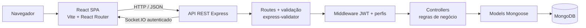
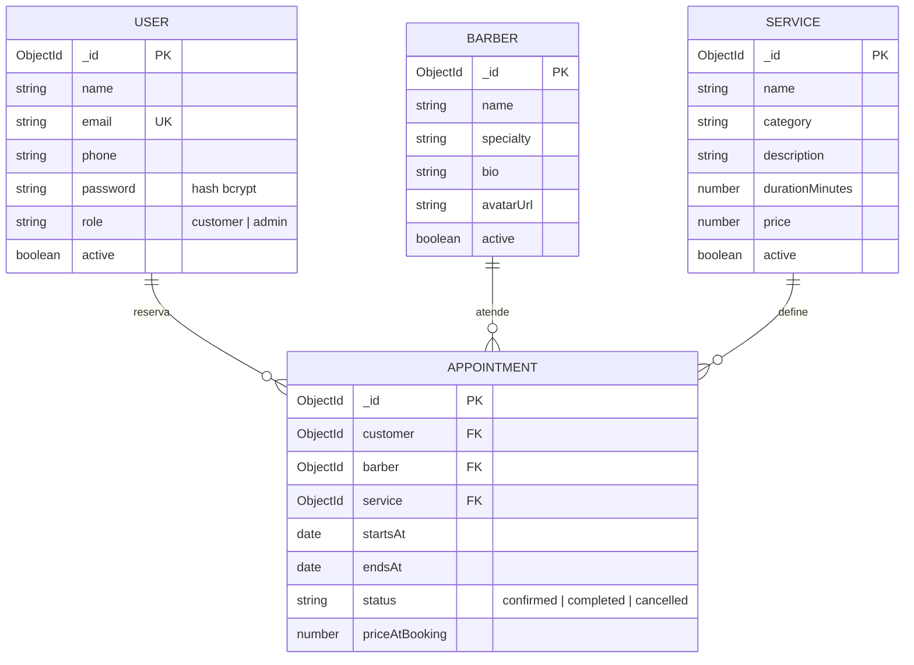
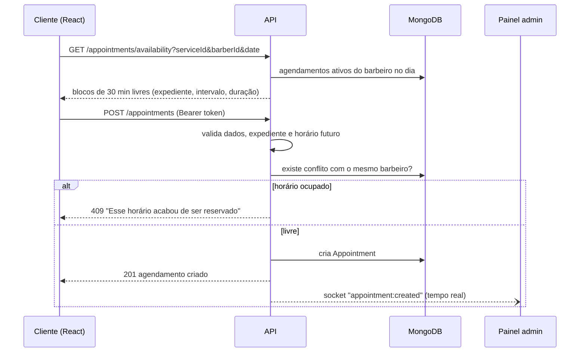

# Arquitetura do Estúdio Street 095

## Visão geral

O frontend é uma SPA em React que conversa com a API só por JSON. A API segue o **MVC adaptado para API**:

| Camada | Pasta | Responsabilidade |
|---|---|---|
| **Model** | `server/src/models` | Schemas Mongoose com tipos, limites e validação (`User`, `Service`, `Barber`, `Appointment`). |
| **View** | resposta JSON | Como o frontend é separado, a "view" do backend é o JSON que cada controller devolve. |
| **Controller** | `server/src/controllers` | Regras de negócio: disponibilidade, conflito de horários, exclusão com histórico e indicadores. |
| Rotas | `server/src/routes` | Verbo HTTP + caminho, validação de entrada e middlewares de acesso. |
| Middleware | `server/src/middleware` | `authenticate` (JWT), `authorize('admin')`, `validate` e tratamento central de erros. |

Em desenvolvimento, o Vite repassa `/api` e `/socket.io` para a porta 4000 (proxy em `client/vite.config.js`). Assim o navegador acessa tudo por `localhost:5173`, sem CORS.

## Entidades e relações

`Appointment` liga um cliente, um barbeiro e um serviço. O valor cobrado fica salvo em `priceAtBooking`, para que mudar o preço no catálogo não altere reservas antigas.

**Exclusão:** ao excluir um serviço ou barbeiro, a API apaga o documento quando não há agendamentos ligados a ele. Se houver, faz exclusão lógica (`active: false`) para preservar o histórico. O item pode ser reativado no painel.

## Perfis de acesso

| Ação | Visitante | Cliente | Admin |
|---|:-:|:-:|:-:|
| Ver serviços, barbeiros e horários livres | ✅ | ✅ | ✅ |
| Criar conta e entrar | ✅ | — | — |
| Reservar horário | — | ✅ | ✅ |
| Ver e cancelar **os próprios** agendamentos | — | ✅ | — |
| Ver toda a agenda, concluir ou cancelar qualquer horário | — | — | ✅ |
| CRUD de serviços e barbeiros | — | — | ✅ |
| Dashboard com indicadores | — | — | ✅ |

O cadastro público sempre cria `role: customer`; a API ignora o campo `role` enviado pelo formulário. O admin é criado pelo script `npm run seed:demo`.

A proteção existe nas duas camadas:

- **Backend (a que vale):** `authenticate` responde **401** sem token ou com token inválido ou expirado; `authorize('admin')` responde **403** para clientes.
- **Frontend (experiência):** `ProtectedRoute` redireciona para o login, e um cliente que tenta abrir `/admin` volta para "Minha conta". Se a sessão expira, o site desloga sozinho e avisa.

## Fluxo de reserva

A disponibilidade é **recalculada no servidor** a cada reserva. Mesmo que duas pessoas cliquem no mesmo horário, só a primeira consegue reservar.

## Segurança

- Senhas com **bcrypt** (custo 12) e nunca devolvidas no JSON (`select: false` + `toJSON`).
- **JWT** com validade configurável (`JWT_EXPIRES_IN`).
- Validação de entrada com **express-validator**, só os campos validados chegam ao banco (`matchedData`), e o Mongoose valida de novo.
- **Helmet**, limite de requisições no login e cadastro, e corpo JSON limitado a 20 KB.
- Erros internos não expõem stack trace ao cliente.
